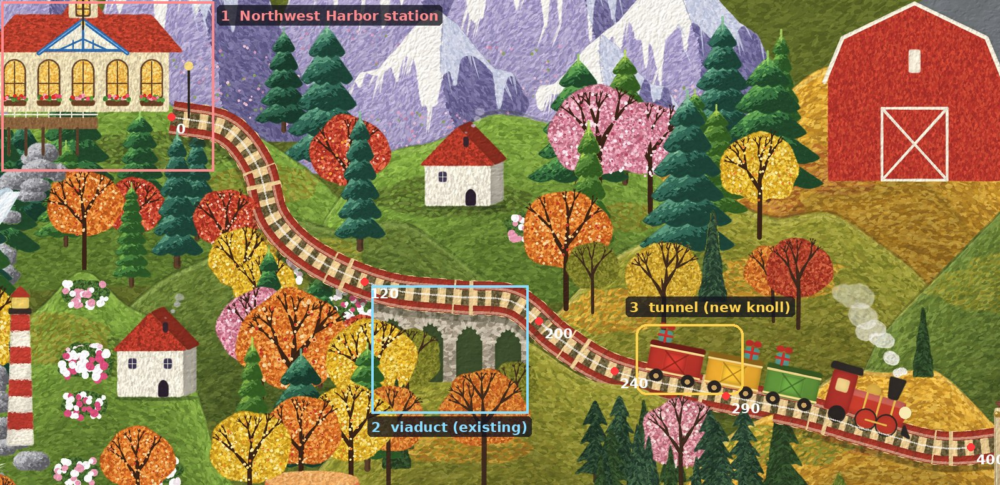

# Integration: from the Engine 10 prototype to the interactive world

Branch `integration/northwest`, started from `develop` on 9 November 2026. Nothing on `main` or `develop` changes, and the
published map and prototype artifacts are untouched.

## 1. The prototype rebuilds exactly

From a clean clone of `develop`:

```
pip install matplotlib==3.11.2          # the other pinned libraries were already present
apt-get install -y tex-gyre             # the Bonum font for the lettering (tft7.FONT)
cd usmap && export PYTHONPATH=../folk2:../styles2:.:lab8:engine10
python3 tools/job.py run pass5_6400 --cpu --mem 3.5 -- python3 usmap5.py --width 6400   # 5.0 min: out5_6400/anim (movers)
python3 tools/job.py run pass5_3200 --cpu --mem 1.5 -- python3 usmap5.py                # 2.1 min: out5/scene5.json
python3 tools/job.py run cache_f1 --cpu -- python3 engine10/cache10.py build 1 0 0 1671 1021   # see note
python3 tools/job.py run cache_f2 --cpu -- python3 engine10/cache10.py build 2 670 200 1190 650
python3 tools/job.py run viewer5 --cpu --mem 2 -- python3 make_viewer4.py out5_6400 viewer5 viewer5_src/index.html
python3 tools/job.py run viewer10 --cpu --mem 2 -- python3 engine10/make_viewer10.py
```

About 16 minutes in total on this machine (4 cores, Python 3.13.18).

**Result.** Each of the 444 files of the rebuilt `viewer10/` was compared with the published "Toy Town Detail
Prototype" artifact. Every image is byte-identical: tiles, occluders and sprites (442 files). `scene.json` and the page
differ only in the build timestamp.

**Note on the 1× build.** `engine10/README.md` §10 gives `cache10.py build 1 0 0 1671 941`. That range ends at canvas
y 3872, so the bottom row of 1024-px tiles (canvas y 4096–4175, sea only) is never painted, and `assemble()` leaves it
black. Building to map y 1021 (the bottom of the padded frame) paints those 7 tiles, 0.7 s each, and the result
matches the published bundle.

## 2. How the engine works, for integration

### Coordinates and projection
- All geometry is in **map units**: the reference image's pixels, 1671 × 941, origin top left, y down.
- Canvas pixel = `(map + (PADL, PADT)) × k`, with `k = K1 × f`, `K1 = 6400/1671 ≈ 3.83`, and padding
  `(PADL, PADT, PADR, PADB) = (100, 70, 80, 80)` (`brush10.py`). At f = 1 the canvas is 7089 × 4175.
- There is no 3D. The picture is an oblique folk-art view, and the third dimension is a single number per element:
  **depth**, the painting order. A larger depth is painted later, so it is nearer. `render10` records `Z` (the depth
  of the element that painted each pixel), `TRK` (the pixel is track) and `OWN` (the element index).

### Tiles and zoom
- The engine paints 1024-px cache tiles. Every mark depends only on its map position and element seed, so a tile
  painted alone equals the same area of a full render (`cache10.py`, verified on the whole map).
- A tile's key hashes the elements it touches, the code and the density. An edit repaints only the tiles it touches.
- `make_viewer10.py` assembles the tiles and writes two Deep Zoom pyramids (1024-px tiles, 14 levels):
  - `base`: the whole map at f = 1;
  - `detail`: Toy Town (map rect 670,200–1190,650) at f = 2.

  The viewer (OpenSeadragon 4.1.0) fades `detail` in between 90% and 135% zoom.

### Railway paths
- Routes are evenly spaced polylines, 1.6 map units apart, built by Catmull-Rom through control points
  (`docs/RAILROAD.md`). Each point carries a **depth** (`scene5.json → routes.*.depth`).
  - The red line is at depth 250 near the Northwest station, 344 and 436 down the hill, 436.01+ on the viaduct, and
    336 and 446 further east.
- The track is painted into the base as `track` elements, so the painted rails and the animation path come from the
  same points.
- The viewer's `scene.json` stores each route in canvas pixels, extended by 50 points at both ends into the station
  buildings (`track_from`/`track_to`). Those extension points have depth −2e9, so everything occludes them, and that
  is how a train disappears into a station hall.

### Sprites and animation
- Sprite kinds: trains (locomotive plus three wagons per route), swaying trees, palm fronds, waves, boats, the
  steamer and its wheel, windmill blades, flags, clouds, and smoke puffs.
- Movers are left out of the base painting. Each mover's **front patch**, the base pixels with
  `Z > its depth` inside its silhouette, is cut out and drawn over it.
- Trains run at a constant speed around the whole route and loop. There are no stops.

### Occlusion and foreground layers
- `make_viewer10.occluder()` builds a band along every route: 14 units either side along the track, 48 units above
  it, 8 below. Inside the band, every base pixel whose `Z` is greater than the track depth at that point (and that is
  not track) becomes an occluder pixel.
- The result is cut into 512-px tiles (26 at 1×, 17 at 2× for Toy Town). The viewer draws the tiles near each train
  over it.
- This is already Approach A: occlusion comes from the painting itself plus one depth number per track point.

### Regional detail paintings
- One region exists, Toy Town at f = 2. Its sprites (trees, flags, trains) have 2× versions, used once the detail
  layer is more than half visible, and it has its own 2× occluder tiles.
- The density ladder (README §6) shows little gain beyond 2×.

### Clickable locations
- None. The only interaction is the region buttons (`data-r="x,y,w,h"` in map units, mapped through `K` and `frame`)
  and the standard pan and zoom.

## 3. Approach A is enough: no heightmap

The test needs three behaviours, and each one is already a case of "paint it at the right depth":

| Need | How it works | New code |
|---|---|---|
| Train passes behind trees and hills | Existing occluder band | none |
| Train crosses the viaduct | Already set up: track depth on the viaduct is just above `VIADUCT_DEPTH`, and trees in front of the arches are moved forward (`usmap4.py`) | none |
| Train enters a tunnel | A hill element painted **just in front of** the track, with dark portal mouths. Its pixels have `Z` > track depth, so the occluder hides the train car by car as it enters. Inside the tunnel the train is fully behind the hill. | the hill-and-portals painter, plus a flag that skips the track between the portals |
| Train stops at the station | Viewer: a pause at a set distance along the route | small |
| Station is clickable | Viewer: a hit area in map units that flies to the station and shows its name | small |

A heightmap would add a second source of truth that must agree with the painting everywhere, for no visible gain.

## 4. Proposed Northwest test section

The red line, from **Northwest Harbor station** (route index 0, the lodge at map ~(90, 120)) to about index 400
(map ~(720, 404)):

- **Station.** The train emerges from the lodge (it already does), and it will now pause at the platform before
  leaving. The lodge gets a hit area.
- **Forest and hillside.** At indices 40–120 the line winds down through firs and autumn trees. The existing occluders
  already put those trees in front of the train.
- **Bridge.** The stone viaduct, at indices about 120–200 (map x 300–410, y 290–380). It is already in the painting.
- **Tunnel (new).** A small wooded knoll crossing the line at indices about **240–290** (map x ≈ 485–560, y ≈ 335–360).
  That is open slope today, between the viaduct and the hill at x 640. The knoll would have:
  - two stone portals in the style of the Toy Town portals;
  - depth just above the track's 336, so it occludes the train;
  - the track skipped between the portals.

  It touches about 2 cache tiles at 1×.
- **Train.** The existing red locomotive and wagons.

The artwork changes in only one place, the knoll and its portals, and only inside this branch. Everything else is
data and viewer behaviour.



The train in this image is the one painted into the pass 5 still. In the viewer it is a moving sprite.

## 5. Plan

1. **Knoll and portals.** Add the painter and scene element, plus a `tunnel` span on the red route that skips its
   ties and rails. Rebuild only the touched tiles. Check with `compare_outputs.py` that nothing else moved.
2. **Spans in `scene.json`.** `{kind: station | bridge | tunnel, s0, s1}` per route, in arc length. Generate them from
   the scene, not by hand.
3. **Viewer.**
   - a station pause and a station hit area, with a fly-to and a name card;
   - optionally, a shadow under the train on the viaduct deck.
4. **Checks.** Extend `test_viewer10.js` with:
   - frames along the section, including tunnel entry and exit, the viaduct and the station pause;
   - a check that the rails and the train line up at the deepest zoom;
   - an fps measurement.

   Then publish a review page.

## 6. Result of the Northwest test (9 November 2026)

Review build: published as the artifact "Northwest Railway Test". Rebuild it with:

```
cd usmap && export PYTHONPATH=../folk2:../styles2:.:lab8:engine10
python3 engine10/nw10.py build      # 1x and 2x tiles from the branch scene (only knoll tiles repaint)
python3 engine10/nw10.py viewer     # viewer_nw/ (the rebuilt original prototype stays in viewer10/)
node engine10/test_nw.js http://localhost:PORT/ OUTDIR openseadragon.min.js
```

**Artwork.** `engine10/tunnel10.py` adds two scene elements, written into `out5/scene5_nw.json` by `nw10.py`. No
existing engine file is edited.
- **The knoll** (`knoll10`, depth 336) is a pass-3 hill painted with `U3.paint_hill3`, the painter every other hill
  uses.
- **Its front** (`tunnel10`, depth 336.3) is the same hill, painted only where it stands in front of the track. It also
  carries the knoll's trees (`tall_fir`, `layered_fir`, one autumn tree) and a stone portal in the style of the map's
  own `portal3`: a mossy cutting, a rough-stone arch, radial joints and a deep mouth.

**Depth order, not geometry.** Two lessons came from this:
- **Depth precision.** The cache stores depth as float16. At 336 its step is 0.25, so a nearer element must be at
  least 0.25 deeper, or it reads as the track's own depth and the occluder misses it.
- **Painting order.** The engine records an element's depth only where it changes a pixel. The front part of the
  knoll must therefore not be painted twice; repainting identical pixels leaves them at the back depth. The knoll
  is split into its back part and its front part with complementary soft masks.

**Tiles.** At 1×, 34 of 35 tiles are pixel-identical to the original prototype. In the 2× Toy Town layer, 18 of 20 are.
The 3 changed tiles all contain the knoll (`engine10/out/nw_tile_check.json`). The 2× layer's rectangle starts at
canvas x 2560 (map x ≈ 568), which is inside the knoll, so it had to be rebuilt from the branch scene too. Without
that rebuild, a hard seam appeared when zooming in.

**Viewer** (`engine10/viewer_nw_src.html`, built from `viewer10_src.html`):
- **Station stop:** an eased stop at Northwest Harbor, about 5 s with idling steam and couplings settling, then a
  slow pull-away whose chuffs speed up with the train.
- **Tunnel entry:** the vehicles darken in the portal's shadow, smoke stops inside the tunnel, and a little smoke
  drifts out of the mouth.
- **Occluder loading:** the occluder tiles along the route are preloaded and looked up ahead of each train.
- **Station hover and click:** hovering shows a label and a window glow; clicking opens a card that follows the
  station as you pan and zoom. The card reports the train's live position and has "Zoom to the station" and "Ride
  the Red Line" buttons. On small screens it docks under the map.
- **Ride along** keeps the camera on the train.

**Checks** (`engine10/out/nw_viewer_test.json`, headless Chromium):
- no console errors on desktop or phone;
- 60 fps at the station and while riding along;
- the card opens at 35%, 73% and 153% zoom, and by tapping on the phone;
- at 509% zoom the train sits on the painted rails.

Frames: `docs/integration_nw_*.jpg`.
