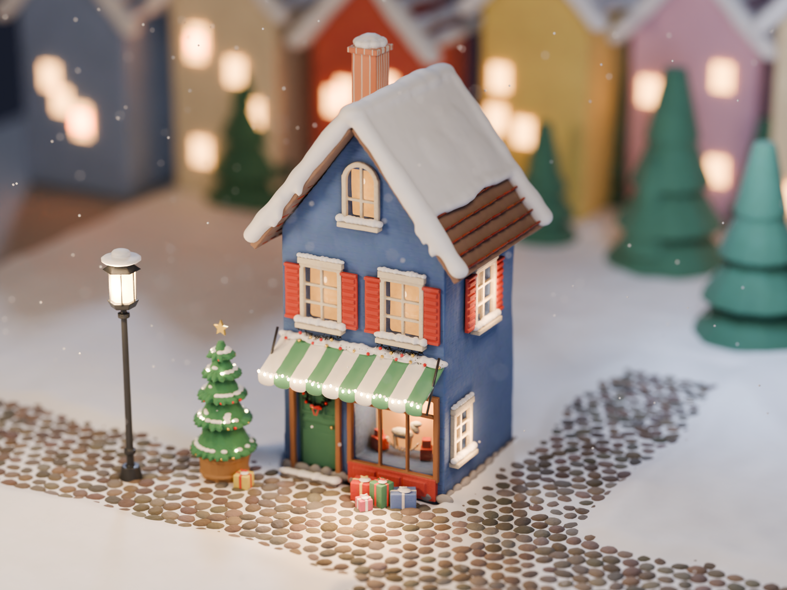

# Claymation Toy Town: one building (feasibility test)

An isolated artistic experiment: the blue Toy Town shop with the green-and-white awning, rebuilt in Blender
as a hand-made miniature set. **Nothing outside this folder is touched or used.** It does not change the
national map, the Toy Town renderer, the railway routes or coordinates, and it is not wired into the website.



## Files

| File | What it is |
|---|---|
| `build_scene.py` | The whole scene, generated from primitives in one Blender Python script (no downloaded assets). |
| `blue_shop_claymation.blend` | The saved project (written by stage 3). Modifier stacks are left live, so it stays editable. |
| `renders/iteration1_architecture.png` | Iteration 1: shapes, proportions, roofline, openings (flat colours). |
| `renders/iteration2_materials.png` | Iteration 2: clay plaster, painted wood, fabric, snow, brick, cobbles. |
| `renders/final_1600x1200.png` | Iteration 3: decorations, lighting, depth of field. The final image. |
| `renders/iterations_compare.jpg` | The three iterations side by side. |
| `renders/final_details.jpg` | 100% crops of the final, to check the craftsmanship. |
| `renders/iteration*_stats.json` | Timings and scene size for each run. |
| `reference/` | The two reference images (the Toy Town illustration and the claymation village). |

No texture images are used: every material is built from Blender's shader nodes.

## Reproduce

Blender **4.2 LTS** (tested with 4.2.9, the official Linux build from download.blender.org):

```bash
blender -b --factory-startup -P build_scene.py -- 1 1200 900 48     # iteration 1, architecture
blender -b --factory-startup -P build_scene.py -- 2 1200 900 64     # iteration 2, materials
blender -b --factory-startup -P build_scene.py -- 3 1600 1200 192   # iteration 3, final (also saves the .blend)
```

The arguments are stage, width, height and samples. Seeds are fixed, so each run gives the same scene; only
the render noise pattern differs slightly before denoising.

## How the hand-made look is built

- **Sculpted, not modelled:** every piece is built from simple blocks, then fused and softened.
  - Each building piece gets a voxel remesh, which turns it into one solid like a lump of clay.
  - A smooth modifier rounds every edge, the way fingers would.
  - A slow, low displacement adds hand-made unevenness.
  - The walls also taper very slightly, and the trims are deliberately chunky.
  - The windows are real recesses cut into thick walls.
- **Snow as a paste:** the roof snow is a slab on each slope.
  - Its edges are continuous "rolled" lips whose thickness drifts slowly, rather than a row of balls.
  - Soft drips hang over the gable.
  - Ledges, the awning, the lamp and the chimney each get their own small fused snow pieces.
  - The street has a dusting that settles between the cobbles, with deeper banks off the lane.
- **Materials:**
  - **Clay plaster:**
    - Paint colour drifts at two scales.
    - Shallow tool marks (smooth Voronoi dents, stretched "spatula" strokes and a fine grain) are mixed at low weights so no pattern dominates.
    - Corners are darkened through ambient occlusion, as a model maker would hand-paint shading into creases.
    - A touch of subsurface scattering and sheen keeps it from reading as plastic.
    - Glitter flecks echo the Toy Town walls.
  - **Painted wood:** a faint grain under the paint, with paint rubbed thin on edges and corners (driven by pointiness).
  - **Awning fabric:** hand-painted stripes with wavering edges, a fine weave and soft sheen.
  - **Snow:** a subsurface white with a sugary grain and occasional glints.
  - **Cobbles and roof tiles:** every stone and tile has its own shape, angle and colour.
- **Light:**
  - A warm soft key, a cool sky fill and a cool moon rim.
  - Warm practical lights: the shop display, every window, the street lamp, string lights and fairy lights.
  - Small warm "spill" lights carry the window glow onto the snow.
  - Filmic tone mapping (AgX, Medium High Contrast).
- **Camera:** a 98 mm lens about 33 units away, so perspective is almost flat. A very shallow aperture (f/0.09)
  gives the depth-of-field fall-off that makes a real miniature set read as small.

## Performance (final render)

| | |
|---|---|
| Blender | 4.2.9 LTS (official Linux build) |
| Engine | Cycles, CPU only (4 cores, no GPU), OpenImageDenoise |
| Resolution | 1600 × 1200 |
| Samples | 192 (adaptive, threshold 0.02) |
| Render time | 60 min 17 s for the final; 7 min for the 1200 × 900 materials pass; 1 min for the architecture pass |
| Scene build time | 3 s (Python), plus modifier evaluation at render time |
| Scene size | 74 mesh objects, about 3.3 million triangles after modifiers, 960 cobbles, 14 lights, 53 materials |
| Memory | about 1 GB peak |
| Saved project | `blue_shop_claymation.blend`, 9 MB (compressed, modifiers live) |

The CPU build only was used: this container has 4 CPU cores and no GPU. On a desktop with a recent GPU,
Cycles would render the same frame roughly 10–30× faster.

- **Engine:** Cycles was practical here. Eevee would be much faster, but its soft shadows, subsurface
  scattering in the snow and clay, and light bouncing off the snow are weaker. Those are exactly what sell the
  miniature, so I didn't try it for the final.
- **Exporting to glTF for the browser:** possible, but not as is.
  - The remesh and smooth modifiers would need applying and the meshes decimating. The street snow and
    fused pieces are about 3 million triangles together; a browser wants a few hundred thousand at most.
  - The procedural materials can't travel in glTF. They would have to be baked into image textures (colour,
    normal, roughness).
  - The lighting, subsurface scattering, soft shadows and depth of field would have to be rebuilt in the
    real-time renderer, and would look clearly flatter than this render.

## Assessment

### What looks convincing
- **It reads as a small physical object.** The long lens, the strong depth-of-field fall-off, the warm-and-cool
  lighting and the out-of-focus village make it look like a photographed miniature, not a game level. This was
  the biggest single gain, in iteration 3.
- **The softened volumes.** Rounded edges everywhere, thick walls with deep recessed windows, chunky trims,
  and a roof snow cushion with a rolled, slightly drooping lip. Nothing is sharp or mathematically straight.
- **The warm practical light.** The glowing display window with the rocking horse, warm panes, string lights
  on the awning, fairy lights on the tree, and the lamp pooling on the snow carry the cozy mood of the reference.
- **The awning.** The cloth sags between stripes, the hem is scalloped, and the stripes waver. It's the most
  "made by hand" element.
- **Identity.** It's clearly the blue Toy Town shop: blue facade, steep gable with an arched attic window, red
  shutters, green-and-white awning, warm shop window.

### What still looks artificial
- **The surfaces are too clean.** At 100% the plaster, wood and snow read as smooth painted ceramic or resin,
  more like a high-end collectible village figurine than plasticine. The claymation reference is covered in
  visible texture: sugary snow, fingerprints, sculpted grooves. Procedural bump at this scale doesn't get there.
  - The roof snow is smooth, like fondant.
  - The roof tiles read as wooden planks.
  - The cobbles look like flat lentils, not set stones.
- **Repetition shows on large areas.** The snowfield and lane edges are smooth and regular, and the
  background trees are plain cones.
- **Detail density.** The reference has wreaths, garlands, bows and lights on everything. The decorations here
  are correct but sparse and a bit small.
- **Render cost.** One frame took an hour on this machine's CPU.

### Can this workflow reach the claymation reference?
**Partly.** The lighting, camera and atmosphere already land; the shapes are close. The missing quality is
almost entirely surface craft, and that is where purely procedural generation is weakest. To close the gap:
1. **Real surface detail.** Use true displacement (adaptive subdivision in Cycles) driven by sculpted or
   photographed clay and snow textures. These can be free and properly licensed (CC0 material libraries
   such as Poly Haven or ambientCG). I didn't use any in this test, since it was meant to stay asset-free.
2. **A few minutes of hand sculpting per building in Blender's sculpt mode:** pressing in the snow, denting
   the walls, rolling the edges. This is what makes stop-motion sets look hand-made, and it is artist time,
   not code.
3. **Denser decoration** built from reusable pieces (wreaths, bows, garlands, lights), placed with Blender's
   geometry nodes.

With those steps, I believe the reference quality is realistic for a set of buildings. From this script
alone, it plateaus at "beautiful miniature figurine" rather than "clay stop-motion".

### Pre-rendered world, or real-time 3D in the browser?
**This experiment points toward pre-rendering a beautiful scene and animating selected elements**, the
same way the folk-art map works today:
- **Pre-rendered.** All of what makes the render read as a miniature would survive pre-rendering:
  path-traced soft light, subsurface scattering in snow and clay, glow from the windows, depth of field.
  Real-time browser rendering (three.js or Babylon) loses most of it. You would get baked textures, a
  fraction of the geometry, approximate shadows and no true depth of field, which is the "video game" look you
  want to avoid. Toy Town could be rendered as large still layers: buildings, foreground and lights.
  Selected things could move on top: trains, the Marines, smoke, twinkling lights, falling snow, a few looping
  rendered animations (a door opening, the tree lights). Short camera moves could be rendered as video.
- **Real-time 3D.** This only makes sense if visitors must freely orbit the town, and that would cost much of
  the beauty shown here.
- **Cost.** About an hour per frame on this CPU, or a few minutes on a desktop GPU. Long animations would
  need a GPU machine or render farm. Single large stills plus a few loops are practical.

Scaling to all of Toy Town is feasible as a pre-rendered set: perhaps 10–15 buildings built from the same
kit (walls, roofs, trims, snow, decorations), each with a short sculpting pass by hand, rendered once at
high resolution. The kit in `build_scene.py` is a starting point for that, not the finished tool.

